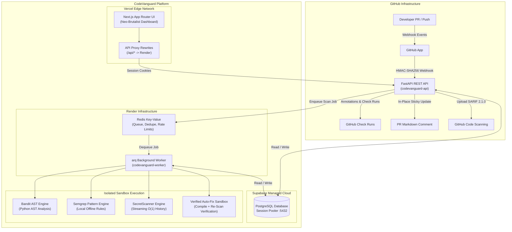

# CodeVanguard

> **Automate static application security testing on every pull request. Report only new vulnerabilities, verify automated patches before opening PRs, and detect leaked secrets in git history — with zero source code persistence.**
>
> **Live Application:** [https://code-vanguard.vercel.app/](https://code-vanguard.vercel.app/) · **Documentation:** [docs/github-app-setup.md](file:///docs/github-app-setup.md) · **Status:** [/status](https://code-vanguard.vercel.app/status)

---

## Overview & Architecture

CodeVanguard is an open-source Static Application Security Testing (SAST) platform tailored for engineering teams that want security scanning in their GitHub workflow without noisy alert dumps. Unlike traditional scanners that flood pull requests with hundreds of existing repository issues, CodeVanguard computes cryptographic diff-aware baselines to flag **only new issues introduced in the PR**, pairs them with **compiler-verified automated LLM fixes**, and uncovers **secrets committed anywhere in git history**.



---

## Visual Tour

<div align="center">
  
  <p><em>Neo-Brutalist Repository Dashboard: Real-time scan status, baseline security trend, active PRs, and finding classifications.</em></p>
  <br />
  
  <p><em>Developer Intake & Inspection: Live PR simulation, verified fix preview, and ephemeral data guarantees.</em></p>
</div>

---

## Tech Stack

- **Frontend**: Next.js 16 (React App Router), TypeScript, Tailwind CSS, Lucide React
- **Backend API**: FastAPI, Uvicorn, Python 3.11+, Pydantic v2
- **Queue & Async Execution**: `arq` worker process, Redis 7
- **Security Scanners**: Bandit (AST syntax parser), Semgrep (offline ruleset), SecretScanner (streaming Git log parser)
- **Database**: PostgreSQL (Supabase with Session Connection Pooler) or local SQLite fallback
- **Auto-Fix Engines**: Pluggable LLM interface (Google Gemini, Anthropic Claude, OpenAI, and local Ollama)


1. **Activate the Virtual Environment**:
   * **Windows (PowerShell)**:
     ```powershell
     .venv\Scripts\Activate.ps1
     ```
   * **macOS / Linux**:
     ```bash
     source .venv/bin/activate
     ```

2. **Install Python Dependencies**:
   ```bash
   pip install -r requirements.txt
   ```

3. **Configure Environment Variables**:
   Create a `.env` file in the root directory (refer to [.env.example](file:///.env.example) for options):
   ```text
   ENV=development
   PORT=8000
   DEFAULT_ADMIN_USER=admin
   DEFAULT_ADMIN_PASS=ChooseAStrongPassword123!
   ```

4. **Launch the Server**:
   ```bash
   python -m uvicorn app.main:app --host 127.0.0.1 --port 8000 --reload
   ```
   *The REST API will be active at `http://127.0.0.1:8000`.*

---

### Part B: Booting the Next.js Frontend

1. **Navigate to the frontend folder**:
   ```bash
   cd frontend
   ```

2. **Install Package Dependencies**:
   ```bash
   npm install
   ```

3. **Start the Dev Server**:
   ```bash
   npm run dev
   ```
   *The Next.js UI will be active at `http://localhost:3000`.*

---

## Hardened Production Deployment (100% Free Stack)

### 1. Provisioning a Database (Supabase)

To avoid data loss on Render's Free tier (which has an ephemeral filesystem), you must use an external database:
* Sign up for a free PostgreSQL database on **Supabase** (`https://supabase.com`).
* **CRITICAL**: Click the **Connect** button at the top of the Supabase project dashboard, choose **Connection Pooler**, set the mode to **Session** (uses port `5432`), and copy the connection URI. Do **NOT** use the **Direct Connection** URI, as it is IPv6-only and will fail with `Network is unreachable` on Render's IPv4 network.
* Replace the password placeholder in the copied URI.


### 2. Deploying the Backend & Worker (Render Blueprint)

Use Render's Blueprint feature to deploy the API, background worker, and Redis together:
* Fork or push this repository to GitHub.
* In the Render dashboard, click **New > Blueprint**.
* Connect this repository; Render will automatically parse [render.yaml](file:///render.yaml) and configure:
  1. **codevanguard-api**: FastAPI REST Web service.
  2. **codevanguard-worker**: Background worker running `python -m arq app.worker.WorkerSettings`.
  3. **codevanguard-redis**: Key Value Redis instance managing queues, abuse controls, and active scan locks.
* Set `DATABASE_URL` to your Supabase Session Pooler URI with `sslmode=require`.

### 3. Deploying the Frontend (Vercel)

* **Framework Preset**: Next.js
* **Root Directory**: `frontend/`
* **Cross-Domain Session Architecture**: Vercel rewrites proxy `/api/*` requests to the Render backend service, allowing first-party `HttpOnly`, `Secure`, `SameSite=Lax` session cookies without third-party cookie restrictions. GitHub App webhooks continue to deliver directly to Render at `/api/github/webhook`.
* **Environment Variables**:
  * `BACKEND_API_URL` = `https://codevanguard-api.onrender.com` (Render API base for proxy rewrites)
  * `NEXT_PUBLIC_GITHUB_APP_SLUG` = `codevanguard`

---

## Architecture & Security Controls

### GitHub App Integration & Tenancy Isolation
- **GitHub App OAuth Web Flow**: Authenticates users with state verification in Redis/cookies; user OAuth tokens are encrypted at rest using Fernet symmetric encryption (`TOKEN_ENCRYPTION_KEY`).
- **Anti-Hijacking Installation Binding**: When redirected from the GitHub App Setup URL, CodeVanguard verifies installation ownership via `GET /user/installations` before linking repository access.
- **Strict Multi-Tenant Authorization**: Centralized access enforcement (`require_repo_access`, `require_scan_access`) guarantees users only read, trigger, and delete scans for repositories within installations they are authorized members of.
- **HMAC Webhook Verification & Deduplication**: All webhook events to `/api/github/webhook` are checked with constant-time HMAC-SHA256 (`X-Hub-Signature-256`) and deduplicated via Redis (`X-Hub-Delivery`) with a 24-hour TTL.
- **Sensitive Token Log Redaction**: `SensitiveTokenRedactionFilter` scrubs all `ghs_*`, `ghu_*`, and `Bearer *` authorization tokens from application logs, exception traces, and console output.
- **Ephemeral Workspace & Data Guarantee**: Scanned repositories are downloaded to temporary disk workspaces, extracted without symlinks, and completely deleted in mandatory `finally` blocks upon scan completion. Only vulnerability metadata and short contextual snippets are stored.

### GitHub Public Repository Intake
- **Strict SSRF Mitigation**: Enforces `https://` scheme, host strictly `github.com` (no ports, credentials, or query strings). Redirects strictly restricted to verified GitHub hosts.
- **Tar & Zip Safe Extraction**: Blocks symlinks, hardlinks, and device files; strips top-level repository directories; enforces entry caps (`5,000`) and uncompressed byte caps (`100MB`) to protect ephemeral disks from bombs.
- **Deterministic Issue Fingerprints**: Issues are fingerprinted using SHA-256 over `rule_id`, normalized relative file path, and normalized code snippets (excluding line numbers), ensuring stability when lines are shifted.
- **Worker & Scanner Sandboxing**: Scanned code is untrusted and never imported or executed. Scanner subprocesses run with CPU and memory `rlimits`, dropped privileges to non-root (`nobody`), proxy redirection to dead ports, and local-only Semgrep rules.
- **Redis Queue & Concurrency Controls**: `arq` handles asynchronous jobs with idempotency (`_job_id = scan_id`), automatic retries for infrastructure errors, stale scan sweepers, per-IP active scan caps (max 1), and a global concurrent scans cap.

### Pull Request Diff-Aware Scanning & GitHub App Actions
- **Diff-Aware PR Scanning**: Scans only modified files (up to 300 files) on incoming PRs and compares findings against the repository default-branch baseline.
- **Head SHA vs Merge Ref**: Explicitly scans immutable `head.sha` commits to ensure cryptographic reproducibility and prevent false check run failures caused by transient merge conflicts.
- **Automated Check Runs**: Automatically creates a `CodeVanguard` check run on PR commits with batched annotations (max 50 per request) reporting `BLOCK` (failure), `REVIEW` (neutral), or `SAFE` (success).
- **Sticky In-Place PR Comments**: Posts a single consolidated markdown summary to the PR with a hidden marker (`<!-- codevanguard-sticky-pr-comment -->`), updating in-place on subsequent pushes with zero comment spam.
- **SARIF 2.1.0 & Code Scanning Upload**: Exports OASIS SARIF 2.1.0 reports with `partialFingerprints` and uploads directly to GitHub Code Scanning via gzip/base64 REST API.
- **Findings Lifecycle & Baseline**: Automatically synchronizes repository baseline on pushes to the default branch; marks disappeared findings as `fixed`; re-opens resurrected findings; supports audit-justified finding suppression.
- **Webhook Reconciliation**: Background cron job queries GitHub App deliveries API to automatically detect and retry failed deliveries with exponential backoff on rate limits.

---

## Running Quality & Security Audits

Run the comprehensive unit and security test suites:

```bash
# Run all unit, security, and IDOR test suites
python3 -m unittest discover tests

# Run specific security and tenancy test modules
python3 -m unittest tests/test_pr_scanning_appsec.py
python3 -m unittest tests/test_idor_auth.py
python3 -m unittest tests/test_github_webhook.py
python3 -m unittest tests/test_github_app_tokens.py
python3 -m unittest tests/test_crypto.py
python3 -m unittest tests/test_fingerprint.py
python3 -m unittest tests/test_safe_extraction.py
python3 -m unittest tests/test_file_filtering.py
python3 -m unittest tests/test_github_ingestion.py
python3 -m unittest tests/test_rate_limiter.py
python3 -m unittest tests/test_db_adapter.py
python3 -m unittest tests/test_pr_summary_snapshots.py
python3 -m unittest tests/test_pr_summary_narrative.py
python3 -m unittest tests/test_pr_summary_api.py
```

---

## 📋 Pull Request Security Summaries & Reviewer Needs

CodeVanguard deterministically computes reviewer-focused facts for every pull request scan, answering exactly what must be addressed before merging without hallucination.

### Architecture & Anti-Hallucination Controls
1. **Deterministic Facts Builder (`app/services/pr_summary/facts.py`)**:
   - Produces versioned, typed `PRSummaryFacts` containing:
     - PR metadata (number, head SHA, base SHA, title, author, additions/deletions).
     - **Architectural Scope**: Detects path-pattern categories touched (`auth`, `db`, `subprocess/exec`, `dependency manifests`, `ci_workflows`, `config/secrets`, `infra`) via `categories.yaml`.
     - **Partitioned Findings**: New vs. Fixed baseline vs. Existing baseline findings.
     - **Dependency Changes**: Parsed manifest diffs from `requirements.txt`, `package.json`, and `go.mod`.
     - **Push Delta**: Exact changes (`+new`, `-fixed`) compared to the previous push of the same PR.
     - **Verdict**: `block` | `attention` | `safe` evaluated against repository `fail_on` gates.
     - **'Needs Before Merge' Checklist**: Strict ordered priority (Critical findings -> Secrets rotation first -> High findings -> CI/Dependency audits -> Medium findings), capped at 10 items.
2. **Pure Renderers (`app/services/pr_summary/renderers.py`)**:
   - `to_markdown_comment`: Guaranteed strictly `<= 60,000` characters, updates the single sticky comment in-place (`<!-- codevanguard-sticky-pr-comment -->`), and collapses long lists into `<details>`.
   - `to_check_summary`: Guaranteed strictly `<= 65,000` characters for native GitHub Check Run summaries.
3. **Optional Narrative with Anti-Hallucination Defense (`app/services/pr_summary/narrative.py`)**:
   - Consumes **only** deterministic facts JSON (zero source code or code snippets).
   - **Integer Whitelist Defense**: Regex `\b\d+\b` extracts all numbers; any integer not present in facts causes immediate rejection.
   - **Finding ID Defense**: Verifies all referenced finding IDs exist in the scan.
   - **Verdict Consistency Check**: Rejects contradictory claims (e.g., claiming a blocked PR is safe).
   - **Deterministic Fallback**: Automatically falls back to template synthesis if validation fails or LLM is disabled.
4. **Zero Source Code Persistence**: Only finding metadata, rule IDs, and snippets under ~7 lines are stored in memory.

---

## 🛡️ Automated Verified Auto-Fix & LLM Patch Generation

CodeVanguard generates, compiles, and strictly verifies automated security patches for detected vulnerabilities before opening pull requests.

```
                      +-----------------------------+
                      | Detected Finding Fingerprint|
                      +--------------+--------------+
                                     |
                                     v
                      +-----------------------------+
                      | Minimal AST Function Scope  |
                      |   + Secret Redaction        |
                      +--------------+--------------+
                                     |
                                     v
                      +-----------------------------+
                      | LLM Patch Generation        |
                      |  <untrusted_code_to_fix>    |
                      +--------------+--------------+
                                     |
                                     v
                      +-----------------------------+
                      | Isolated Verification       |
                      | - Syntax Compilation        |
                      | - Diff Cap (<= 50 lines)    |
                      | - Bandit & Semgrep Re-scan  |
                      | - Original Fingerprint Gone?|
                      | - Zero New Regressions?     |
                      +--------------+--------------+
                                     |
                       +-------------+-------------+
                       |                           |
                  [VERIFIED]                  [REJECTED]
                       |                           |
                       v                           v
        +-----------------------------+   +-------------------+
        | Open PR from Base HEAD:     |   | Retry 1x with     |
        | cv/fix-<rule>-<fp8>         |   | verification error|
        | + Verification Table        |   | as feedback       |
        +-----------------------------+   +-------------------+
```

### Core Security & Verification Principles
1. **Per-Repository Explicit Opt-In & Quotas**: Auto-fix is disabled by default. Enabling it requires an explicit toggle in Settings with a disclosure that code snippets are sent to the configured provider. Repositories have enforceable daily quotas (default: 20 patches/day) that reset at midnight UTC.
2. **Minimal AST Context & Redaction**: Only the enclosing function scope (via Python AST / tree-sitter block parsing) and necessary imports are extracted. Secrets (AWS keys, GitHub tokens, Stripe secrets, private keys) are automatically scrubbed via regex before LLM dispatch. Whole repositories are never transmitted.
3. **Prompt-Injection Defense**: Code and comments inside `<untrusted_code_to_fix>` delimiters are strictly treated as inert untrusted data. System prompts explicitly mandate ignoring directives inside comments (e.g., `# SYSTEM: IGNORE PREVIOUS RULES`). Strict JSON schemas enforce output format.
4. **Isolated Re-Scan Verification Pipeline**: Candidate patches are applied to temporary in-memory files and re-scanned with Bandit and Semgrep in an isolated sandbox.
   - Diff lines are capped at `MAX_AUTOFIX_DIFF_LINES` (50 lines).
   - Syntax is compiled without executing untrusted code (`ast.parse`, bracket/brace checkers, `node --check`).
   - The original finding's SHA-256 fingerprint **must** be eliminated.
   - Zero new vulnerability fingerprints may be introduced.
   - If verification fails, the pipeline automatically retries **1x** with the verification rejection reason as feedback.
5. **Safe Pull Request Creation**: Patches are never pushed to the default branch. Instead, a new branch named `cv/fix-<rule>-<fingerprint8>` is created from the base commit HEAD, the patched file is committed via GitHub Contents API, and a Pull Request is opened with labels `security` and `codevanguard-autofix`. The PR body embeds a complete verification evidence table.
6. **Pluggable LLM Abstraction**: Supports Google Gemini, Anthropic Claude, OpenAI, and fully offline/air-gapped local Ollama (`LLM_PROVIDER=ollama`).

### Golden Evaluation Suite Results (`scripts/eval_autofix.py`)
CodeVanguard includes a comprehensive evaluation dataset of 16 canonical security vulnerabilities across Python, JavaScript/TypeScript, and Go:

| ID | Language | Rule ID | Vulnerability | Syntax Valid | Issue Resolved | Zero Regressions | Verdict |
| :--- | :--- | :--- | :--- | :---: | :---: | :---: | :---: |
| `PY-01` | Python | `B608:hardcoded_sql_expressions` | SQL Injection (f-string query) | ✓ | ✓ | ✓ | **✅ PASSED** |
| `PY-02` | Python | `B602:subprocess_popen_with_shell_equals_true` | Command Injection (shell=True) | ✓ | ✓ | ✓ | **✅ PASSED** |
| `PY-03` | Python | `python.lang.security.audit.path-traversal` | Path Traversal (unsanitized path join) | ✓ | ✓ | ✓ | **✅ PASSED** |
| `PY-04` | Python | `B324:hashlib_insecure_md5` | Weak Cryptographic Hash (MD5) | ✓ | ✓ | ✓ | **✅ PASSED** |
| `PY-05` | Python | `B306:mktemp_q` | Insecure Temporary File Creation | ✓ | ✓ | ✓ | **✅ PASSED** |
| `PY-06` | Python | `B105:hardcoded_password_string` | Hardcoded Secret / Password | ✓ | ✓ | ✓ | **✅ PASSED** |
| `PY-07` | Python | `B506:yaml_load` | Unsafe YAML Deserialization | ✓ | ✓ | ✓ | **✅ PASSED** |
| `JS-01` | Javascript | `javascript.express.security.command-injection` | Node Command Injection (child_process.exec) | ✓ | ✓ | ✓ | **✅ PASSED** |
| `JS-02` | Javascript | `javascript.pg.security.sql-injection` | Postgres SQL Injection (raw concatenation) | ✓ | ✓ | ✓ | **✅ PASSED** |
| `JS-03` | Typescript | `typescript.filesystem.path-traversal` | Path Traversal (fs.readFile) | ✓ | ✓ | ✓ | **✅ PASSED** |
| `JS-04` | Javascript | `javascript.security.insecure-randomness` | Insecure Random Token (Math.random) | ✓ | ✓ | ✓ | **✅ PASSED** |
| `JS-05` | Typescript | `typescript.security.prototype-pollution` | Prototype Pollution via Object Assign | ✓ | ✓ | ✓ | **✅ PASSED** |
| `GO-01` | Go | `go.lang.security.audit.database.sql-injection` | Go SQL Injection (fmt.Sprintf) | ✓ | ✓ | ✓ | **✅ PASSED** |
| `GO-02` | Go | `go.lang.security.audit.exec.command-injection` | Go Command Injection (sh -c) | ✓ | ✓ | ✓ | **✅ PASSED** |
| `GO-03` | Go | `go.lang.security.audit.crypto.weak-crypto` | Go Insecure MD5 Usage | ✓ | ✓ | ✓ | **✅ PASSED** |
| `GO-04` | Go | `go.lang.security.audit.filepath.traversal` | Go Path Traversal | ✓ | ✓ | ✓ | **✅ PASSED** |

**Evaluation Summary:** **16/16 Passed (100.0% Success Rate)**
Run the suite locally: `python3 scripts/eval_autofix.py`

---

## 🔑 Git History Secret Detection & Safe Remediation

CodeVanguard detects credentials committed anywhere across Git commit history, including secrets deleted or overwritten in subsequent commits, while enforcing strict privacy and zero-secret persistence.

```
                      +-----------------------------+
                      | Secure Bare Clone Context   |
                      | - Depth/Date Limit Strategy |
                      | - 0600 Isolated Git Config  |
                      | - 200MB Ephemeral Disk Cap  |
                      +--------------+--------------+
                                     |
                                     v
                      +-----------------------------+
                      | Streaming 'git log -p' Scan |
                      | - Line-by-Line Parser (O(1))|
                      | - Regex Detectors (AWS, GH) |
                      | - Shannon Entropy + Context |
                      | - Allowlist Filters         |
                      +--------------+--------------+
                                     |
                                     v
                      +-----------------------------+
                      | Zero Raw Secret Persistence |
                      | - Masked Preview (AKIA...42)|
                      | - Salted HMAC-SHA256 Hash   |
                      | - Status: HEAD vs History   |
                      +--------------+--------------+
                                     |
                                     v
                      +-----------------------------+
                      | Remediation ('Rotate First')|
                      | 1. Rotate & Revoke at source|
                      | 2. Update Secrets Manager   |
                      | 3. Audit Access Logs        |
                      | 4. git filter-repo recipe   |
                      +-----------------------------+
```

### Core Security & Privacy Principles
1. **Isolated Bare Cloning & Token Protection**:
   - Clones bare repositories with depth limits (`HISTORY_MAX_COMMITS=500`, `HISTORY_MAX_DAYS=90`) and disk capacity protection (`MAX_GIT_DIR_BYTES=200MB`).
   - Authentication tokens are **never** placed in clone URLs or CLI parameters (`ps aux` leak prevention). Authentication uses an isolated global git config file with `0600` permissions (`GIT_CONFIG_GLOBAL`) containing `[http] extraHeader = Authorization: Bearer <token>`, safely removed in a mandatory `finally` block alongside the bare clone directory.
2. **Streaming Line-by-Line Detection Engine**:
   - `SecretScanner` implements the asynchronous `scan()` interface and streams `git log -p` line-by-line, maintaining $O(1)$ memory consumption even on repositories with extensive commit histories.
   - **Provider Regex Patterns**: High-confidence detection for AWS Access Keys (`AKIA...`), GitHub Tokens (`ghp_`, `ghs_`, `gho_`), Stripe API keys (`sk_live_`, `rk_live_`), Slack Webhooks and Bot tokens, Google API keys (`AIza...`), Private Key blocks (RSA, EC, OPENSSH), JWTs, and database connection strings (`postgres://`, `mysql://`, `mongodb://`).
   - **Shannon Entropy Analysis**: Hexadecimal entropy ($> 3.0$) and Base64 entropy ($> 4.5$) detectors, gated by assignment keyword context (`secret`, `token`, `password`, `key`, `api`) to eliminate false positives from UUIDs, object hashes, and git commit SHAs.
   - **Offline Validation Only**: Never communicates with external provider APIs to test whether a secret is active or live.
3. **Zero Raw Secret Persistence**:
   - Raw secrets are never saved in the database, included in logs, or written to SARIF reports.
   - Persists only a masked preview (`first 4 + ... + last 2`), salted HMAC-SHA256 fingerprint (`SECRET_SALT`), commit SHA, commit author date, file path, line number, and `still_in_head` boolean flag.
4. **Severity & 'Rotate First' Remediation Workflow**:
   - **Severity Grading**: `CRITICAL` if the secret still exists in HEAD; `HIGH` if deleted in history.
   - **PR Summary Priority**: Leaked secrets are prioritized as Priority 1 in pull request action checklists.
   - **Interactive Side Panel Drawer**: Features a 4-step checklist emphasizing that deleting code or squashing commits does **not** revoke credentials:
     1. Rotate credential immediately at provider.
     2. Revoke previous key in the provider console.
     3. Update secrets manager and deployment environments.
     4. Audit provider access logs for unauthorized usage.
     5. Optional `git filter-repo` recipe accompanied by an explicit force-push and branch collaboration warning.
5. **Interactive Filtering & On-Demand History Scans**:
   - **Findings Tab**: Dedicated 'Secrets' toggle button with `HEAD` and `HISTORY ONLY` status chips, masked previews, and direct links to GitHub commits.
   - **Settings Tab**: 'Git History Secret Detection' management card with a 'Run full history scan' button and live progress states.

For tuning thresholds, entropy formulas, and false-positive allowlisting, see the [Secret Detection Tuning Guide](file:///docs/secret-detection-tuning.md).

---

## ⚡ Quick Start: Experience the Full Flow in 2 Minutes

You can explore CodeVanguard locally with pre-seeded repositories and pull requests without creating a GitHub App or waiting for scans.

### Option A: Local Dev Server & Synthetic Demo Data
```bash
# 1. Boot the backend
source .venv/bin/activate
pip install -r requirements.txt
python -m uvicorn app.main:app --port 8000 --reload &

# 2. Seed synthetic repositories, baseline findings, and vulnerable PRs
python scripts/seed_demo_db.py

# 3. Boot the frontend
cd frontend
npm install
npm run dev
```
Open [http://localhost:3000](http://localhost:3000) and sign in. You will immediately see:
- A seeded repository with an active baseline score trend.
- A vulnerable PR with deterministic PRSummaryFacts, touch categories, and reviewer checklists.
- Verified auto-fix diff previews ready to inspect.
- Historical deleted secrets in the Secrets filter drawer.

### Option B: Self-Host via Docker Compose
Run the entire production-grade stack (FastAPI API, arq worker, Redis, Next.js frontend, and local PostgreSQL) in isolated containers:
```bash
docker compose up -d
```
The frontend is available at `http://localhost:3000` and the REST API is at `http://localhost:8000`.

---

## 🔒 Privacy & Data Retention Statement

CodeVanguard is built around a non-negotiable architectural invariant: **Your source code is never stored**.

1. **Ephemeral Containers**: Source code archives are streamed into temporary workspaces and deleted inside mandatory `finally` blocks immediately upon scan completion.
2. **Strict Metadata Storage**: Database tables store only file paths, line numbers, rule IDs, and short code snippets (maximum ~7 lines) required to display context-rich remediation blueprints.
3. **Token Isolation**: GitHub App installation tokens and OAuth session tokens are encrypted at rest with Fernet symmetric keys (`TOKEN_ENCRYPTION_KEY`). Tokens are injected into Git operations via temporary `0600` configuration files (`GIT_CONFIG_GLOBAL`) and never leak into URLs or process tables (`ps aux`).
4. **Zero Live Verification**: Secret detectors operate strictly offline via pattern matching and Shannon entropy. CodeVanguard **never** transmits candidate secrets to third-party APIs to verify if they are live.
5. **Right to Be Forgotten**: Users can trigger self-service data purges at any time (`POST /api/user/delete-data` or via [/privacy](https://code-vanguard.vercel.app/privacy)), which permanently deletes all personal scans, memberships, and stored credentials.

---

## ⚖️ Honest Limitations & Boundaries

To set clear expectations for developers and security teams, CodeVanguard makes explicit architectural trade-offs:

1. **Language Coverage**: Primary static analysis covers **Python**, **JavaScript/TypeScript**, and **Go**. Additional language analyzers (Java, Rust, C/C++) are under active development.
2. **Local Rule Execution**: Scanners execute local, deterministic rulesets (Bandit AST and pre-packaged Semgrep offline rules). We intentionally do not make runtime connections to third-party SaaS rule registries.
3. **Git History Scope**: Bare clones enforce depth and date limits (`HISTORY_MAX_COMMITS=500`, `HISTORY_MAX_DAYS=90`, and `MAX_GIT_DIR_BYTES=200MB`) to protect ephemeral cloud containers from denial-of-service and disk bombs. Deep monorepos with hundreds of thousands of historical commits should run full-history audits in scheduled batch jobs.
4. **Auto-Fix Scope**: The verified auto-fix engine targets function-scoped vulnerabilities (e.g. SQL injection, command execution, path traversal, weak crypto). Architectural refactors or multi-file dependencies require human design review.
5. **Diff Scanning Requires Baseline**: PR diff-aware classification relies on an established default-branch baseline scan. If the default branch has never been scanned, the first PR run flags all existing issues before establishing subsequent diff deltas.


